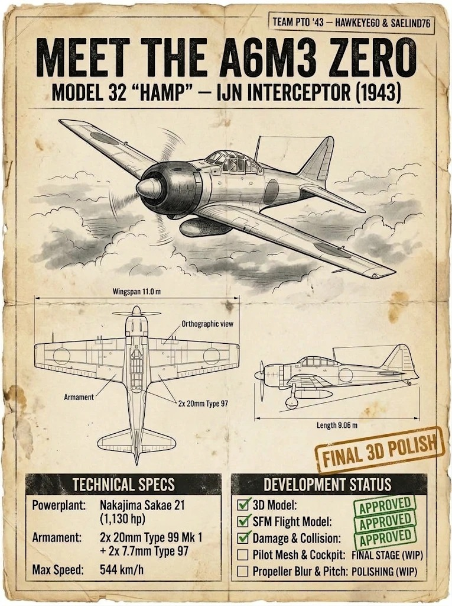

# Meet the A6M3 Zero ("Hamp")

  

**Mitsubishi A6M3 Zero Model 32 "Hamp" — IJN interceptor (1943)**

| | |
| :--- | :--- |
| **Role** | Carrier / land-based interceptor |
| **Coalition** | JAP (Imperial Japan) |
| **Team** | Team PTO '43 — Hawkeye60 & Saelind76 |

## Technical Specifications

| Parameter | Value |
| :--- | :--- |
| **Powerplant** | Nakajima Sakae 21 (1,130 hp) |
| **Armament** | 2x 20 mm Type 99 Mk 1 + 2x 7.7 mm Type 97 |
| **Convergence** | Harmonized at 250 m |
| **Max speed** | 544 km/h |
| **Wingspan** | 11.0 m |
| **Length** | 9.06 m |
| **Source of measurements** | [TODO] Official source / booklet (current values come from the poster) |

<!-- CHECK: poster wingspan 11.0 m and length 9.06 m are not verified against an official source. -->

## Development Status

Status per the Google Sheet "PTO'43 Modpack - Tracker" (tab "PTO'43 Aircraft").

| Verified 3D Source | Movable Parts | Physcal Propeller | Sec/AA | Textures | Liveries | SFM | Collision Models | X-ray Implemented |
| :---: | :---: | :---: | :---: | :---: | :---: | :---: | :---: | :---: |
| ✅ | ❌ | ❌ | ❌ | ✅ | ❌ | ✅ | ✅ | ❌ |

Overall status: **FINAL 3D POLISH** (per the poster).

### Poster checklist
- [x] 3D model (Model 32 airframe with clipped wingtips)
- [x] SFM flight model (Sakae 21 power curve, high-roll clipped wings)
- [x] Damage & collision (standardized light fighter damage cells and fuel tanks)
- [ ] Pilot mesh & cockpit (final stage, WIP)
- [ ] Propeller blur & pitch (polishing Arg 0 visibility and blur material, WIP)
- [ ] PBR RoughMet & liveries

## Remarks

- Sheet remark: "propeller is a disc".

## Sources & Credits

- Specifications: PTO '43 poster; [TODO] official source or booklet.
- Development status: Google Sheet "PTO'43 Modpack - Tracker".
- Model, scripting and liveries: see [LICENSE.md](../../../../LICENSE.md).
