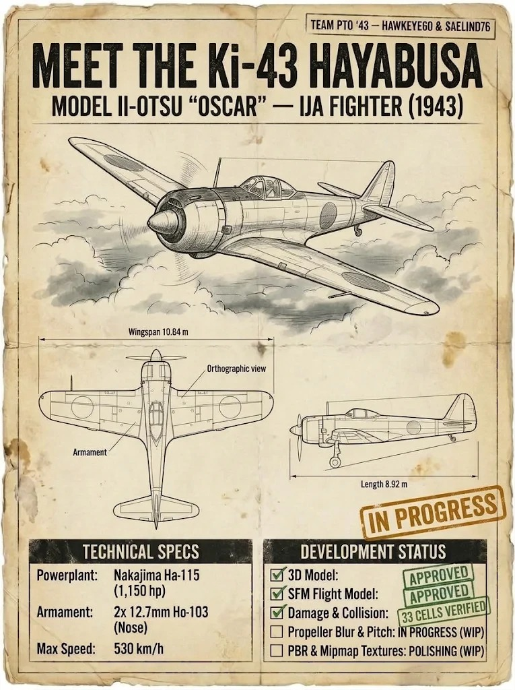

# Meet the Ki-43 Hayabusa ("Oscar")

  

**Nakajima Ki-43-II Otsu Hayabusa "Oscar" — IJA fighter (1943)**

| | |
| :--- | :--- |
| **Role** | IJA army fighter |
| **Coalition** | JAP (Imperial Japan) |
| **Team** | Team PTO '43 — Hawkeye60 & Saelind76 |

## Technical Specifications

| Parameter | Value |
| :--- | :--- |
| **Powerplant** | Nakajima Ha-115 14-cylinder radial (1,150 hp) |
| **Armament** | 2x 12.7 mm Ho-103 synchronized nose machine guns |
| **Ordnance** | Up to 2x 250 kg bombs / jettisonable drop tanks |
| **Max speed** | 530 km/h |
| **Wingspan** | 10.84 m |
| **Length** | 8.92 m |
| **Source of measurements** | [TODO] Official source / booklet (current values come from the poster) |

<!-- CHECK: poster wingspan 10.84 m and length 8.92 m are not verified against an official source. -->

## Development Status

Status per the Google Sheet "PTO'43 Modpack - Tracker" (tab "PTO'43 Aircraft").

| Verified 3D Source | Movable Parts | Physcal Propeller | Sec/AA | Textures | Liveries | SFM | Collision Models | X-ray Implemented |
| :---: | :---: | :---: | :---: | :---: | :---: | :---: | :---: | :---: |
| ❌ | ✅ | ❌ | ❌ | ❌ | ❌ | ✅ | ✅ | ✅ |

Overall status: **IN PROGRESS** (per the poster).

### Poster checklist
- [x] 3D model (radial cowling and butterfly combat flaps)
- [x] SFM flight model (Ha-115 power curve, lightweight turn envelope)
- [x] Damage & collision (33 collision shells + 29 internal X-ray innards)
- [ ] Propeller blur & pitch (WIP, fixing blade/blur visibility arguments)
- [ ] PBR & mipmap textures (WIP, re-exporting DDS with mipmaps and weathering pass)

## Remarks

- Propeller disc and blade transition still being fixed.

## Sources & Credits

- Specifications: PTO '43 poster; [TODO] official source or booklet.
- Development status: Google Sheet "PTO'43 Modpack - Tracker".
- Model, scripting and liveries: see [LICENSE.md](../../../../LICENSE.md).
