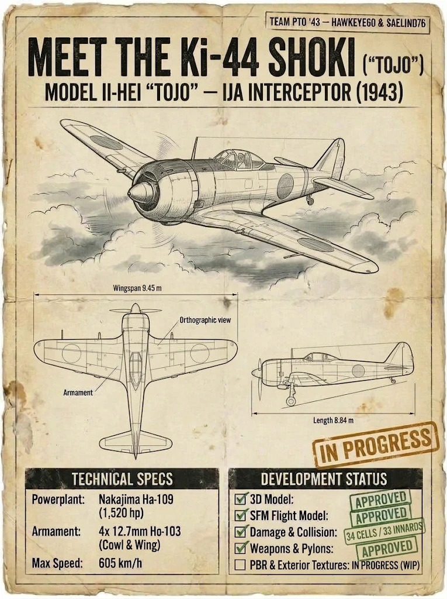

# Meet the Ki-44 Shoki ("Tojo")

  

**Nakajima Ki-44-II Hei Shoki "Tojo" — IJA interceptor (1943)**

| | |
| :--- | :--- |
| **Role** | IJA point-defense interceptor |
| **Coalition** | JAP (Imperial Japan) |
| **Team** | Team PTO '43 — Hawkeye60 & Saelind76 |

## Technical Specifications

| Parameter | Value |
| :--- | :--- |
| **Powerplant** | Nakajima Ha-109 14-cylinder twin-row radial (1,520 hp) |
| **Armament** | 4x 12.7 mm Ho-103 (2x synchronized cowl + 2x wing) |
| **Ordnance** | 2x Type 97 (60 kg) or 2x Type 98 (250 kg) bombs |
| **Max speed** | 605 km/h |
| **Wingspan** | 9.45 m |
| **Length** | 8.84 m <!-- Value taken from the poster; not yet checked against an official source. -->  |
| **Source of measurements** | [TODO] Official source / booklet (current values come from the poster) |

## Development Status

Status per the Google Sheet "PTO'43 Modpack - Tracker" (tab "PTO'43 Aircraft").

| Verified 3D Source | Movable Parts | Physcal Propeller | Sec/AA | Textures | Liveries | SFM | Collision Models | X-ray Implemented |
| :---: | :---: | :---: | :---: | :---: | :---: | :---: | :---: | :---: |
| ❌ | ✅ | ❌ | ❌ | ✅ | ✅ | ✅ | ✅ | ✅ |

Overall status: **IN PROGRESS** (per the poster).

### Poster checklist
- [x] 3D model
- [x] SFM flight model
- [x] Damage & collision (34 collision shells + 33 internal X-ray innards)
- [x] Weapons & pylons
- [ ] PBR & exterior textures (WIP)

## Remarks

- Liveries and weathering pass in progress.

## Sources & Credits

- Specifications: PTO '43 poster; [TODO] official source or booklet.
- Development status: Google Sheet "PTO'43 Modpack - Tracker".
- Model, scripting and liveries: see [LICENSE.md](../../../../LICENSE.md).
