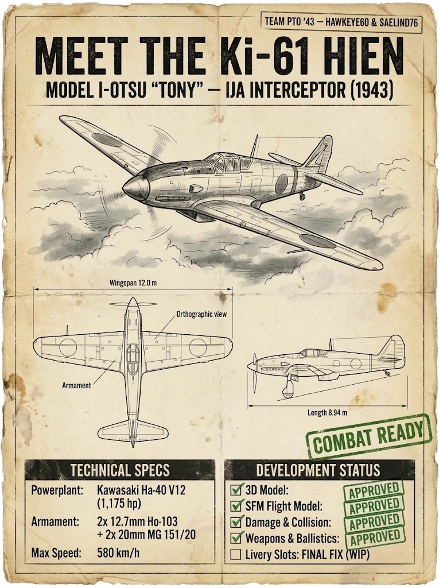

# Meet the Ki-61 Hien ("Tony")

  

**Kawasaki Ki-61-I Otsu Hien "Tony" — IJA interceptor (1943)**

| | |
| :--- | :--- |
| **Role** | IJA high-altitude interceptor |
| **Coalition** | JAP (Imperial Japan) |
| **Team** | Team PTO '43 — Hawkeye60 & Saelind76 |

## Technical Specifications

| Parameter | Value |
| :--- | :--- |
| **Powerplant** | Kawasaki Ha-40 inverted V12 (1,175 hp) |
| **Armament** | 2x 12.7 mm Ho-103 + 2x 20 mm MG 151/20 |
| **Protection** | 13 mm pilot head/seat armor + self-sealing tanks |
| **Max speed** | 580 km/h |
| **Wingspan** | 12.0 m |
| **Length** | 8.94 m |
| **Source of measurements** | [TODO] Official source / booklet (current values come from the poster) |

<!-- CHECK: poster wingspan 12.0 m and length 8.94 m are not verified against an official source. -->

## Development Status

Status per the Google Sheet "PTO'43 Modpack - Tracker" (tab "PTO'43 Aircraft").

| Verified 3D Source | Movable Parts | Physcal Propeller | Sec/AA | Textures | Liveries | SFM | Collision Models | X-ray Implemented |
| :---: | :---: | :---: | :---: | :---: | :---: | :---: | :---: | :---: |
| ✅ | ✅ | ❌ | ❌ | ✅ | ❌ | ✅ | ✅ | ✅ |

Overall status: **COMBAT READY** (per the poster; sheet remark: "prepared to battle").

### Poster checklist
- [x] 3D model (inline Ha-40 cowling, ventral radiator bath)
- [x] SFM flight model (high-speed dive and energy-fighting envelope)
- [x] Damage & collision (34 collision shells + 32 internal X-ray innards, 13 mm seat armor)
- [x] Weapons & ballistics (2x Ho-103 + 2x MG 151/20 harmonized)
- [ ] Livery slots (final texture slot cleanup, WIP)

## Remarks

- Final livery material slot cleanup in progress.

## Sources & Credits

- Specifications: PTO '43 poster; [TODO] official source or booklet.
- Development status: Google Sheet "PTO'43 Modpack - Tracker".
- Model, scripting and liveries: see [LICENSE.md](../../../../LICENSE.md).
